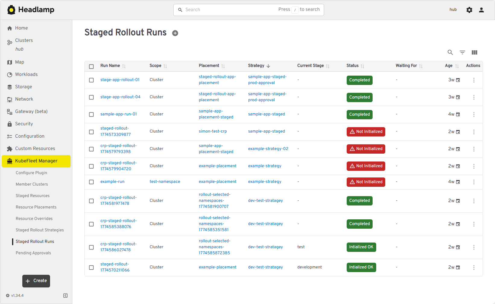

# KubeFleet Manager Headlamp Plugin

[](https://artifacthub.io/packages/search?repo=kubefleet-manager)

A Headlamp plugin for managing KubeFleet resources via a hub cluster, providing visibility into multi-cluster fleet operations.



## Prerequisites

The target cluster must have the [KubeFleet](https://kubefleet.dev/) CRDs and hub-agent installed. You can access the cluster using its `kubeconfig`.

The easiest way to get going is to try the [KubeFleet quickstart using kind clusters](https://kubefleet.dev/docs/getting-started/kind/) on your local computer.

## Experimental placement policies

Select your hub in **KubeFleet Manager → Configure Plugin**, then open
**Placement Policies (Alpha)** to inspect `PlacementPolicy` and
`ClusterPlacementPolicy` resources in `placement.kubefleet.dev/v1alpha1`.
The hub must have the experimental placement-policy APIs installed and enabled.
Annotation-generated policies also require annotation-based placement to be enabled.

The read-only list and details show source ownership, resource and cluster
selectors, generation-aware conditions, cluster counts, snapshot revision,
auto-rollout configuration, and per-cluster bindings with resource failures.
Missing APIs and authorization errors are reported explicitly. Access requires
`get`, `list`, and `watch` on the policy and binding resources in that API group.
Namespaced resources are queried in their namespace when viewing details.

Generated policy specs are controller-managed: change placement through the
source resource's `kubefleet.dev/cluster-selectors` annotation. This view does not
create, edit, or delete policies. The existing **Resource Placements** pages
continue to use the older `placement.kubernetes-fleet.io` APIs.

## Development

The plugin requires you have Headlamp (https://headlamp.dev/) available on your machine if you want an end-to-end debugging experience.

```bash
npm install
npm start   # watch mode
npm run build
npm run tsc
npm run lint
CI=true npm test
```
